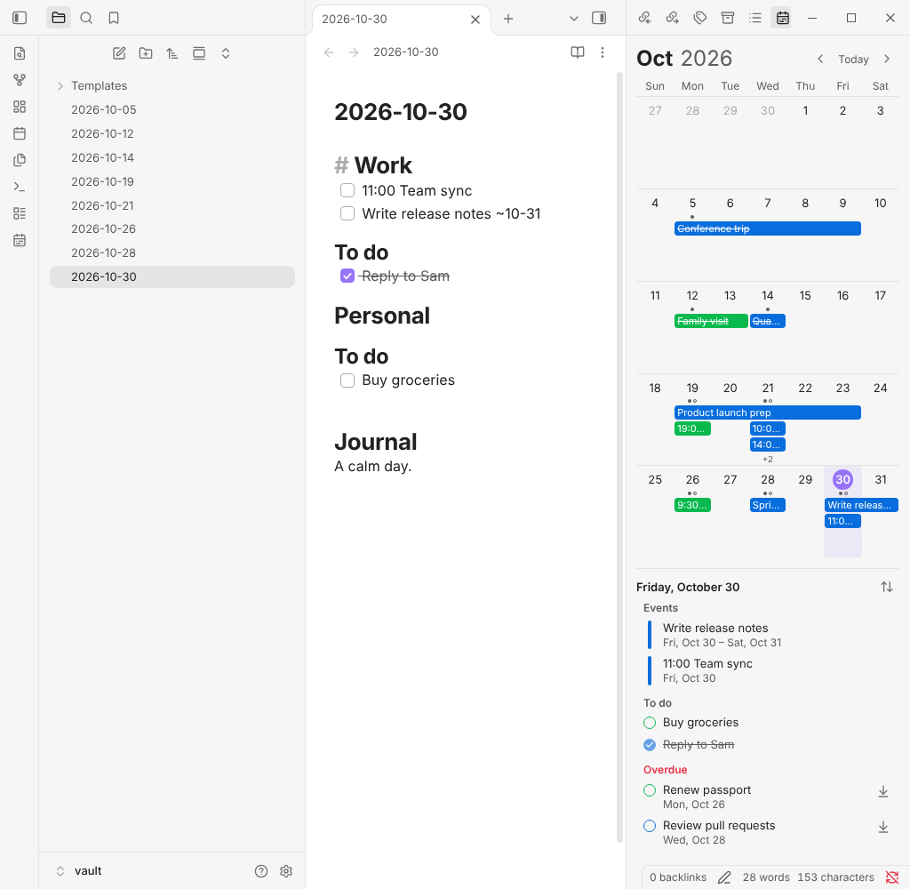
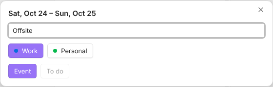
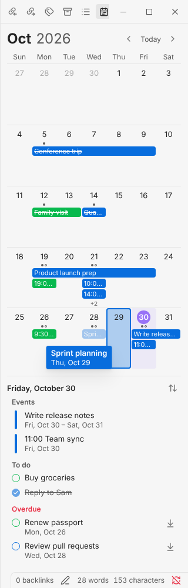
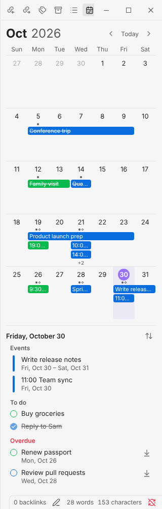
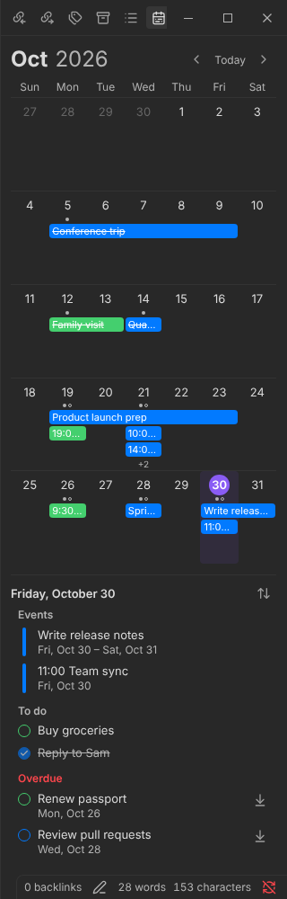

# Sidebar Calendar

일일 노트에 적은 일정을 [옵시디언](https://obsidian.md) 사이드바의 월간 Calendar로 보여줍니다.

[English](README.md) · **한국어**



> [!NOTE]
> **베타 (0.1)입니다.** 데스크톱에서만 동작합니다. 옵시디언 1.14로 윈도우와 리눅스에서 확인했습니다. 문제가 있으면 [Issues](https://github.com/Nagnero/obsidian-sidebar-calendar/issues)에 남겨 주세요.

- [기능](#기능)
- [빠르게 시작하기](#빠르게-시작하기)
- [일정 적는 법](#일정-적는-법)
- [사용법](#사용법)
- [설정](#설정)
- [자주 묻는 질문](#자주-묻는-질문)
- [설치](#설치)

## 기능

- **여러 날 막대.** 여러 날에 걸친 일정을 날짜를 가로지르는 막대로 그립니다. 막대에는 제목이 들어가고 종류마다 색이 다릅니다.
- **일정과 할 일.** 일정은 Calendar에 그려지고, 할 일은 그날 목록에만 나옵니다.
- **끌어서 추가하고 옮기기.** 여러 날을 끌어서 추가하고, 막대를 끌어서 옮기고, 막대 끝을 끌어서 기간을 바꿉니다.
- **목록에서 바로 체크.** Calendar 아래 목록에서 바로 체크합니다. 여러 날 일정은 기간 중 어느 날에서든 됩니다.
- **지난 할 일.** 이전 날짜에 못 끝낸 할 일을 오늘 목록에 보여줍니다.
- **노트는 그대로 마크다운.** 모든 내용은 일일 노트의 줄에서 읽고 그 줄에 다시 씁니다.

## 빠르게 시작하기

1. 코어 플러그인 **일일 노트**를 켜고 템플릿을 지정합니다.
2. 템플릿에 일정 종류마다 최상위 제목을 하나씩 적습니다.

   ```markdown
   # 업무

   # 개인
   ```

3. **Sidebar Calendar**를 설치하고 켭니다([설치](#설치) 참고). 오른쪽 사이드바에 Calendar가 열립니다.
4. Calendar에서 며칠을 끌어서 선택하고, 제목을 적은 뒤 Enter를 누릅니다.

## 일정 적는 법

템플릿의 제목 하나가 **종류** 하나입니다. 일일 노트에서 그 제목 바로 아래의 체크박스 항목 하나가 일정 하나이고, 그 노트의 날짜에 시작합니다.

```markdown
# 업무
- [ ] 10시 디자인 리뷰
- [ ] 부산 출장 ~10-23
  - 숙소 예약 완료
## To do
- [ ] PR 리뷰하기
```

| 이렇게 적으면 | 이렇게 됩니다 |
| --- | --- |
| `# 업무` 아래 `- [ ] 제목` | **일정**. Calendar에 막대로 그려집니다 |
| `## To do` 아래 `- [ ] 제목` | **할 일**. 그날 목록에만 나옵니다 |
| 줄 끝에 `~10-23` | 10월 23일까지 이어지는 일정 (`~10/23`, `~2026-10-23`도 됩니다) |
| 제목 앞에 `10:00`, `9:30`, `18시`, `오후 3시` | 그날 목록이 시간 순서로 정렬됩니다 |
| 들여쓴 줄 | 일정에 대한 메모. 일정이 아닙니다 |
| 체크박스 없는 `- 제목` | 표시되지 않습니다. **체크박스 없는 항목도 표시**를 켜면 일정이 됩니다 |

## 사용법

### 일정 추가

여러 날을 끌거나 날짜를 더블클릭합니다. 종류와 **Event**(일정) 또는 **To do**(할 일)를 고르고, 제목을 적고 Enter를 누릅니다. 그 날짜에 일일 노트가 없으면 템플릿으로 새로 만듭니다.



### 일정 옮기기

막대나 목록 항목을 다른 날짜로 끌어다 놓습니다. 끄는 중에 Calendar 위에서 휠을 굴리면 다른 주로 갈 수 있습니다. Esc를 누르면 취소됩니다.



일정을 우클릭해서 **Move to date…**를 골라도 됩니다.

### 기간 바꾸기

막대 오른쪽 끝을 끌거나, 일정을 우클릭해서 **Change duration…**을 고릅니다. 할 일은 하루짜리라서 기간이 없습니다.

### 체크하기와 노트 열기

- 할 일의 동그라미를 누르거나, 목록 항목을 더블클릭하면 체크됩니다.
- 막대나 목록 항목을 누르면 그 줄에서 일일 노트가 열립니다.

### 지난 할 일

오늘을 선택하면 **지난 할 일**에 이전 날짜의 안 끝낸 할 일이 나옵니다. 옆의 화살표를 누르면 오늘로 옮겨집니다.

### 날짜 넘겨보기

- Calendar 위에서 휠을 굴리면 한 주씩 넘어갑니다. 위쪽 월 표시는 맨 윗줄의 달을 따릅니다.
- **‹**와 **›**는 한 달씩 넘기고, **Today**는 오늘로 돌아옵니다.
- 사이드바가 짧으면 Calendar는 한 주만 보여주고, 목록은 따로 스크롤됩니다.

| 라이트 | 다크 |
| --- | --- |
|  |  |

## 설정

설정 맨 위의 **언어 (Language)**에서 한국어로 바꿀 수 있습니다.

- **언어** [기본값: English]: 설정 화면과 목록 묶음 이름의 언어입니다.
- **종류**: 템플릿 제목마다 종류로 쓸지와 색상을 정합니다.
- **주 시작 요일** [기본값: 일요일]: 일요일 또는 월요일입니다.
- **주당 일정 수** [기본값: 3]: 이보다 많은 일정은 `+N`으로 표시됩니다.
- **막대 모양** [기본값: 제목]: **제목**은 제목이 들어간 막대, **선**은 얇은 막대입니다.
- **하루짜리 일정 표시** [기본값: 켬]: 끄면 여러 날 일정만 그립니다.
- **Calendar에서 숨길 소제목** [기본값: To do]: 할 일을 적는 소제목 이름입니다.
- **체크박스 없는 항목도 표시** [기본값: 끔]: 일반 목록 항목도 일정으로 읽습니다.
- **지난 할 일 표시** [기본값: 켬]: 오늘을 선택했을 때 이전 날짜의 할 일을 보여줍니다.
- **일일 노트** [기본값: 켬]: 노트가 있는 날에 점을, 안 끝낸 할 일이 있으면 빈 원을 표시합니다.

목록 머리 오른쪽 버튼으로 목록을 정렬하거나 완료한 항목을 숨길 수 있습니다.

## 자주 묻는 질문

### 일정이 Calendar에 안 보여요.

다음을 확인해 주세요.

- 줄에 체크박스(`- [ ]`)가 있는지, 또는 **체크박스 없는 항목도 표시**가 켜져 있는지
- 템플릿의 `#` 제목 바로 아래 항목인지(들여쓰지 않았는지)
- 설정의 **종류**에서 그 제목이 켜져 있는지

### Calendar를 닫았어요. 어떻게 다시 여나요?

왼쪽 리본의 달력 아이콘을 누르거나, 명령어 팔레트에서 **Sidebar Calendar: Open calendar**를 실행합니다.

### 되돌릴 수 있나요?

열려 있는 노트는 편집기를 통해 바뀌므로 그 편집기에서 Ctrl+Z로 되돌릴 수 있습니다. 일정을 옮기면 노트 두 개가 바뀌므로 각각 되돌려야 합니다.

### 모바일에서 되나요?

아직 안 됩니다. 데스크톱 버전이 안정되면 지원할 예정입니다.

### 구글 캘린더 같은 다른 캘린더와 동기화되나요?

아니요. 일일 노트만 읽고 씁니다.

## 설치

### 베타 기간에는 BRAT으로 설치

1. 커뮤니티 플러그인에서 [BRAT](https://github.com/TfTHacker/obsidian42-brat)을 설치하고 켭니다.
2. 명령어 **BRAT: Add a beta plugin for testing**을 실행하고 `Nagnero/obsidian-sidebar-calendar`를 입력합니다.
3. **설정 → 커뮤니티 플러그인**에서 **Sidebar Calendar**를 켭니다.

새 버전이 나오면 BRAT이 설치해 줍니다.

### 직접 설치

1. [최신 릴리스](https://github.com/Nagnero/obsidian-sidebar-calendar/releases/latest)에서 `main.js`, `manifest.json`, `styles.css`를 내려받습니다.
2. `<볼트>/.obsidian/plugins/sidebar-calendar/` 폴더에 넣습니다.
3. 옵시디언을 다시 불러오고 **설정 → 커뮤니티 플러그인**에서 **Sidebar Calendar**를 켭니다.

### 커뮤니티 플러그인으로 설치

아직 커뮤니티 플러그인 목록에 등록되지 않았습니다. 베타 기간이 끝나면 등록할 예정이며, 등록 후에는 **설정 → 커뮤니티 플러그인 → 탐색**에서 **Sidebar Calendar**를 검색해 설치할 수 있습니다.

## 개발

```bash
npm install      # Node 20 이상
npm run dev      # 바뀔 때마다 main.js 다시 빌드
npm run build    # 배포용 빌드
npm test && npm run lint
```

볼트의 `.obsidian/plugins/sidebar-calendar`에 클론하면 바로 써볼 수 있습니다. `.claude/skills/verify-sidebar-calendar/scripts/readme-shots.sh`는 화면 캡처를 다시 만듭니다.

## 라이선스

[MIT](LICENSE)
