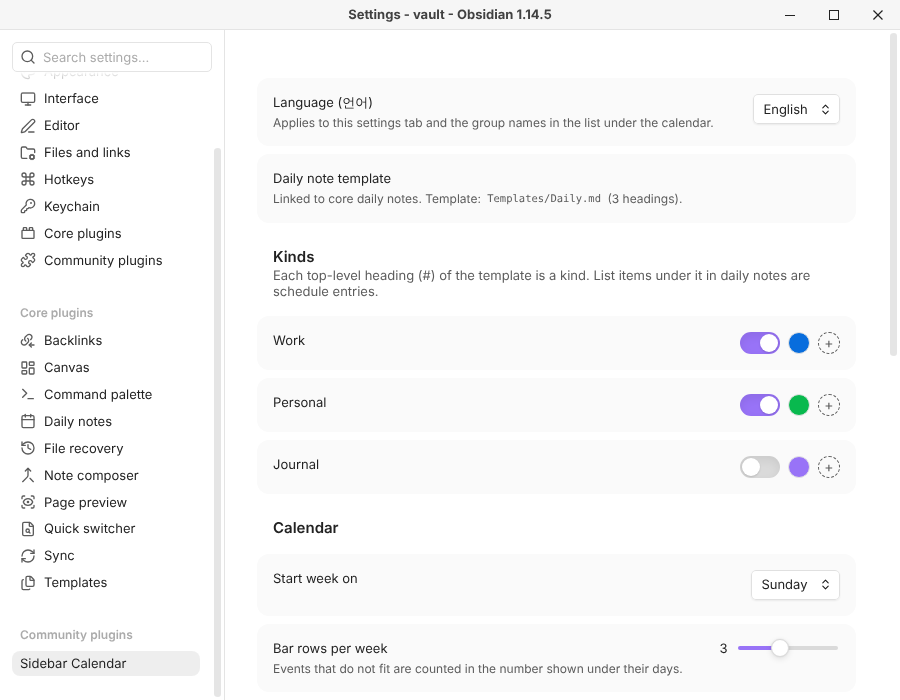

# Sidebar Calendar

[한국어](README.ko.md)

A monthly calendar for the Obsidian sidebar that shows the schedule you keep in your daily notes. Entries that span several days are drawn as colored bars across the dates, and to-dos for the day sit in a list under the calendar.

Your notes stay plain Markdown. The plugin reads list items under the headings of your daily note template, and everything you do in the calendar (adding, moving, checking, changing durations) is written back to those lines.


> **Beta.** This is version 0.1, tested on Windows and Linux desktops with Obsidian 1.14. It is desktop only for now. Please report problems on the [issue tracker](https://github.com/Nagnero/obsidian-sidebar-calendar/issues).

## Features

- Multi-day entries as bars with their titles, colored by kind, light and dark themes.
- Events and to-dos: events are drawn on the calendar; to-dos under a `## To do` heading are listed for their day only.
- Add an entry by dragging across days or double-clicking a day.
- Move an entry by dragging its bar or its row onto another day, even into another month.
- Change a duration by dragging the end of a bar or from the context menu.
- Check tasks off from the list under the calendar, from any day an entry covers.
- Overdue to-dos from earlier days listed on today, with a button to move them to today.
- Dots for days with a daily note, and a ring when the note has unchecked tasks.
- Week-by-week scrolling, and a one-week view when the sidebar is short.
- Settings in English or Korean.

## Requirements

- Obsidian 1.7.2 or later, on desktop.
- The core **Daily notes** plugin, turned on, with a template.

## Installation

### During the beta, with BRAT

1. Install and enable [BRAT](https://github.com/TfTHacker/obsidian42-brat) from the community plugins.
2. Run the command **BRAT: Add a beta plugin for testing** and enter `Nagnero/obsidian-sidebar-calendar`.
3. Enable **Sidebar Calendar** under **Settings → Community plugins**.

BRAT keeps the plugin up to date with new releases.

### Manually

1. Download `main.js`, `manifest.json` and `styles.css` from the [latest release](https://github.com/Nagnero/obsidian-sidebar-calendar/releases/latest).
2. Put them in `<your vault>/.obsidian/plugins/sidebar-calendar/`.
3. Reload Obsidian and enable **Sidebar Calendar** under **Settings → Community plugins**.

### From the community plugins

Not yet. Once the plugin is accepted, search for **Sidebar Calendar** under **Settings → Community plugins → Browse**.

## Getting started

### 1. Set up the template

The calendar takes its **kinds** of entries from the top-level headings (`#`) of your daily note template. For example:

```markdown
# Work

# Personal

# Journal
```

`Work`, `Personal` and `Journal` become kinds. In **Settings → Sidebar Calendar**, give each kind a color, and turn off headings that are not a schedule, like `Journal`.

### 2. Write entries in daily notes

Each top-level task under a kind's heading is one entry, starting on the note's date:

```markdown
# Work
- [ ] 10:00 Design review
- [ ] Conference trip ~10-23
  - Hotel booked
## To do
- [ ] Review pull requests

# Personal
- [x] 19:00 Dinner with Mina
```

- **Events** are tasks directly under the kind's heading. They are drawn on the calendar.
- **To-dos** are tasks under the `## To do` sub-heading. They are meant for their own day: they are listed under the calendar but not drawn on it.
- `~10-23`, `~10/23` or `~2026-10-23` at the end of a line makes the entry last until that day.
- A time at the start of the title (`9:30`, `14:00`, `18시`, `오후 3시`, `3pm`) orders the day's entries.
- Indented lines are notes about the entry and are not read.
- Only items with a checkbox (`- [ ]` or `- [x]`) are entries. Turn on **Show items without a checkbox** to read plain list items as events too.

A section runs from its `#` heading to the next `#` heading, so deeper headings like `## Afternoon` stay part of it. The `## To do` region ends at the next heading of the same or a higher level.

## Using the calendar

Open it from the ribbon icon or the command **Sidebar Calendar: Open calendar**.

| Do this | To |
| --- | --- |
| Click a date | See its events, to-dos and (on today) overdue to-dos below the calendar, and open its daily note if it has one |
| Drag across dates, or double-click a date | Add an entry. Pick its kind, and **Event** or **To do** |
| Drag a bar, or a row from the list, onto a date | Move the entry to that day. Wheel over the calendar while dragging to reach other weeks. Escape cancels |
| Drag the right end of a bar | Change when the entry ends |
| Click the circle of a to-do, or double-click a task in the list | Check or uncheck it |
| Click a bar or a row in the list | Open the daily note at that line |
| Right-click a bar, a row, or an entry line in a daily note | **Change duration…** (events) or **Move to date…** |
| Wheel over the calendar | Scroll a week at a time; the header names the month of the top row |


On today, **Overdue** lists unchecked to-dos from earlier days. The arrow next to one moves it to today.

The button at the right of the list header sorts the list (**Start date**, **Note order**, **Unchecked first**, **Kind**) and can hide completed entries.

When the sidebar is too short to show the month and the list together, the calendar shows one week and the list scrolls on its own.

| Light | Dark |
| --- | --- |
|  |  |

## Settings



| Setting | What it does |
| --- | --- |
| **Language (언어)** | English or Korean for the settings tab and the group names in the list |
| **Kinds** | One row per template heading: use it as a kind or not, and its color |
| **Start week on** | Sunday or Monday |
| **Bar rows per week** | Bars shown per week before the rest are counted as `+N` |
| **Bar style** | **Title** draws filled bars with titles; **Line** draws thin bars |
| **Show one-day entries** | Off draws only entries that span several days |
| **Sub-heading hidden from the calendar** | The sub-heading for to-dos, `To do` by default |
| **Show items without a checkbox** | Also read plain list items as events |
| **Show overdue to-dos** | List earlier days' unchecked to-dos on today |
| **Daily notes** | Dots and rings for days with notes |

## Good to know

- Changes to a note that is open go through its editor, so you can undo them there. Moving an entry changes two notes; undo them one at a time.
- A note for a day that has none is created from your template when you add or move an entry there.
- The plugin only reads and writes daily notes. It does not sync with other calendars.

## Development

1. Clone this repository into `<your vault>/.obsidian/plugins/sidebar-calendar`.
2. `npm install` (Node 20 or later).
3. `npm run dev` rebuilds `main.js` on every change; `npm run build` makes a production build.
4. `npm test` and `npm run lint` run the tests and the linter.
5. In Obsidian, reload and enable **Sidebar Calendar** under **Settings → Community plugins**.

`.claude/skills/verify-sidebar-calendar/scripts/readme-shots.sh` rebuilds the screenshots in `docs/images` from a sample vault.

## License

[MIT](LICENSE)
