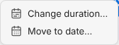
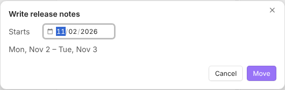

# Sidebar Calendar

A monthly calendar in the [Obsidian](https://obsidian.md) sidebar for the schedule you keep in your daily notes.

**English** · [한국어](README.ko.md)


> [!NOTE]
> **Beta (0.1).** Desktop only. Tested on Windows and Linux with Obsidian 1.14. Please report problems in [Issues](https://github.com/Nagnero/obsidian-sidebar-calendar/issues).

- [Features](#features)
- [Quick start](#quick-start)
- [Writing entries](#writing-entries)
- [Using the calendar](#using-the-calendar)
- [Settings](#settings)
- [FAQ](#faq)
- [Installation](#installation)

## Features

- **Multi-day entries at a glance.** An entry that spans several days is one bar from its first day to its last, with its title and a color per kind.
- **Events and to-dos.** Events go on the calendar. To-dos stay in the list for their day.
- **Drag to add and move.** Drag across days to add an entry, drag a bar to move it, drag its end to change its length.
- **Check off from the list.** Tick tasks in the list under the calendar, from any day an entry covers.
- **Overdue to-dos.** Unfinished to-dos from earlier days show up on today.
- **Your notes stay Markdown.** Everything is read from and written back to lines in your daily notes.

## Quick start

1. Turn on the core **Daily notes** plugin and set a template.
2. Give the template a top-level heading (an H1, starting with a single `#`) for each kind of entry:

   ```markdown
   # Work

   # Personal
   ```

3. Install and enable **Sidebar Calendar** (see [Installation](#installation)). The calendar opens in the right sidebar.
4. In the calendar, drag across the days the entry should cover, or double-click a single day. A dialog opens: type a title and press Enter. The entry is added to that day's daily note.

## Writing entries

Each top-level heading of the template (an H1 like `# Work`) is a **kind**. Under it in a daily note, every top-level task is one entry that starts on the note's date.

```markdown
# Work
- [ ] 10:00 Design review
- [ ] Conference trip ~10-23
  - Hotel booked
## To do
- [ ] Review pull requests
```

| You write | You get |
| --- | --- |
| `- [ ] Title` under `# Work` | An **event**, drawn on the calendar |
| `- [ ] Title` under a `To do` sub-heading | A **to-do**, listed for its day only. Any level from `##` to `######` works |
| `~10-23` at the end | An entry that lasts until Oct 23 (`~10/23` and `~2026-10-23` work too) |
| `10:00`, `9:30`, `18시`, `3pm` at the start | Ordering by time in the day's list |
| An indented line | A note about the entry, not an entry |
| `- Title` without a checkbox | Nothing, unless **Show items without a checkbox** is on |

## Using the calendar

### Add an entry

Drag across days, or double-click one. Pick a kind and **Event** or **To do**, type a title, and press Enter. A daily note that does not exist yet is created from your template.


### Move an entry

Drag a bar, or a row from the list, onto another day. Wheel over the calendar while dragging to reach other weeks. Press Escape to cancel.


You can also right-click an entry and choose **Move to date…**. Pick the new start day; the dialog previews the new range.

 

### Change how long it lasts

Drag the right end of a bar, or right-click an event and choose **Change duration…**. To-dos are meant to be finished within their day, so they have no duration.

### Check off and open notes

- Click the circle of a to-do, or double-click any task in the list, to check it.
- Click a bar or a row to open the daily note at that line.

### Overdue to-dos

When today is selected, **Overdue** lists unchecked to-dos from earlier days. The arrow next to one moves it to today.

### Moving between dates

- The wheel over the calendar scrolls a week at a time. The header shows the month of the top row.
- **‹** and **›** jump by month, and **Today** comes back.
- When the Obsidian window is too short to show the whole month and the list below it, the calendar shows one week. The calendar and the list then scroll separately.

| Light | Dark |
| --- | --- |
|  |  |

## Settings

- **Language** [default: English]: English or Korean for the settings and the list's group names.
- **Kinds**: For each template heading, whether it is a kind, and its color.
- **Start week on** [default: Sunday]: Sunday or Monday.
- **Bar rows per week** [default: 3]: More entries than this show as `+N`.
- **Bar style** [default: Title]: **Title** draws bars with titles. **Line** draws thin bars.
- **Show one-day entries** [default: on]: Off draws only entries that span several days.
- **Sub-heading hidden from the calendar** [default: To do]: The sub-heading for to-dos.
- **Show items without a checkbox** [default: off]: Also read plain list items as events.
- **Show overdue to-dos** [default: on]: List earlier days' to-dos on today.
- **Daily notes** [default: on]: A dot for days with a note, and a ring when it has unchecked tasks.

The button at the right of the list header sorts the list and can hide completed entries.

## FAQ

### My entries don't show up.

Check that:

- the line has a checkbox (`- [ ]`), or **Show items without a checkbox** is on;
- it is a top-level item under a `#` heading of your template;
- that heading is turned on under **Kinds** in the settings.

### I closed the calendar. How do I get it back?

Click the calendar icon in the left ribbon, or run **Sidebar Calendar: Open calendar** from the command palette.

### Can I undo a change?

Changes to a note that is open go through its editor, so Ctrl+Z works there. Moving an entry changes two notes, so undo it in each.

### Does it work on mobile?

Not yet. Mobile support will come after the desktop version is stable.

### Does it sync with Google Calendar or other calendars?

Not yet. It only reads and writes your daily notes for now; syncing with other calendars is planned.

## Installation

### During the beta, with BRAT

1. Install and enable [BRAT](https://github.com/TfTHacker/obsidian42-brat) from the community plugins.
2. Run **BRAT: Add a beta plugin for testing** and enter `Nagnero/obsidian-sidebar-calendar`.
3. Enable **Sidebar Calendar** under **Settings → Community plugins**.

BRAT installs new releases for you.

### Manually

1. Download `main.js`, `manifest.json` and `styles.css` from the [latest release](https://github.com/Nagnero/obsidian-sidebar-calendar/releases/latest).
2. Put them in `<vault>/.obsidian/plugins/sidebar-calendar/`.
3. Reload Obsidian and enable **Sidebar Calendar** under **Settings → Community plugins**.

### From the community plugins

The plugin is not in the community plugins list yet. It will be submitted after the beta. Once it is accepted, search for **Sidebar Calendar** under **Settings → Community plugins → Browse**.

## Development

```bash
npm install      # Node 20 or later
npm run dev      # rebuild main.js on every change
npm run build    # production build
npm test && npm run lint
```

Clone into `<vault>/.obsidian/plugins/sidebar-calendar` to try it in a vault.

## License

[MIT](LICENSE)
